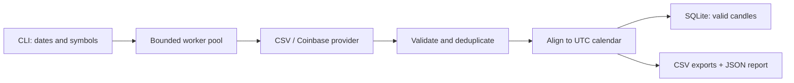

# Market Data Pipeline

**Turn daily crypto candles into validated, aligned datasets you can inspect and reuse.**

[](https://github.com/harper698/market-data-pipeline/actions/workflows/ci.yml)

[简体中文](README.zh-CN.md) · [Quick start](#quick-start) · [Demo output](examples/demo-output/) · [Data contract](#data-contract) · [Architecture](#architecture)

A Python command-line tool that fetches multiple markets concurrently, checks each candle, makes missing days visible, and saves valid observations to SQLite. A deterministic offline demo lets you evaluate the entire pipeline without an API key or network access.

This is an independent data engineering portfolio project. It demonstrates ingestion, data validation, fault handling, persistence, and reproducible verification.

## What it does

- **Fetch:** read local CSV fixtures or request public Coinbase Exchange daily candles; split long ranges into API-sized requests.
- **Recover:** retry transient network failures, HTTP 429, and server errors with bounded backoff and explicit timeouts.
- **Validate:** reject malformed timestamps, invalid prices, impossible OHLC relationships, and invalid volume; report rejected rows and conflicting duplicates.
- **Align:** create a complete UTC daily calendar per symbol, preserving missing candles as null values with an explicit flag.
- **Persist:** transactionally upsert valid candles into SQLite using `(source, symbol, timestamp)` as the unique key.
- **Inspect:** export aligned observations, a wide closing-price matrix, and a JSON quality report. Successful symbols are retained when another symbol fails.

## Tech stack

Python 3.11+ · pandas · requests · SQLite · pytest · Ruff · GitHub Actions

`concurrent.futures` provides bounded parallel fetching. SQLite requires no separate database server. The project uses small modules with explicit responsibilities rather than optimizing for an arbitrary line count.

## Quick start

### 1. Install

```sh
git clone https://github.com/harper698/market-data-pipeline.git
cd market-data-pipeline
python -m venv .venv
```

Activate the virtual environment:

| Shell | Command |
| --- | --- |
| Windows PowerShell | `.venv\Scripts\Activate.ps1` |
| Windows Command Prompt | `.venv\Scripts\activate.bat` |
| macOS / Linux | `source .venv/bin/activate` |

```sh
python -m pip install -r requirements.txt
```

If PowerShell blocks activation, use `.venv\Scripts\python.exe` in place of `python`, then run `.venv\Scripts\marketpipe.exe` in place of `marketpipe`. No execution-policy change is required.

### 2. Run the offline demo

The following single-line command works in PowerShell and POSIX shells:

```sh
marketpipe --provider csv --data-dir examples/raw --symbols BTC-USD ETH-USD --start 2025-01-01 --end 2025-01-08 --db output/demo.sqlite --output output/demo
```

The fixtures are **synthetic**, not recorded market prices. They deliberately contain bad observations, duplicates, and missing days so you can inspect how the pipeline handles imperfect inputs. The seven-day window creates seven aligned rows per successfully fetched symbol, including any missing rows.

Verified results for the included fixtures:

| Symbol | Input rows | Valid candles | Missing days | Rejected rows | Duplicate rows | Conflicting timestamps |
| --- | ---: | ---: | ---: | ---: | ---: | ---: |
| BTC-USD | 7 | 5 | 2 | 1 | 1 | 1 |
| ETH-USD | 7 | 7 | 0 | 0 | 0 | 0 |

The run produces **14 aligned rows and 12 persisted candles**. Repeating it keeps the candle count at 12 while adding a new row to the `runs` audit table. Browse the checked-in [demo output](examples/demo-output/) (`aligned.csv`, `closes.csv`, and `quality.json`) to inspect the result without installing anything. The checked-in `quality.json` contains the demo's quality statistics; a normal run writes the full `report.json` described below.

Open the generated files:

| File | Purpose |
| --- | --- |
| `output/demo.sqlite` | Persistent valid candle history, separated by source |
| `output/demo/aligned.csv` | One row per successful symbol and requested day, including gaps |
| `output/demo/closes.csv` | UTC dates as rows and symbols as closing-price columns |
| `output/demo/report.json` | Per-symbol quality counts and fetch failures |

### 3. Fetch real daily candles

```sh
marketpipe --provider coinbase --symbols BTC-USD ETH-USD --start 2025-01-01 --end 2025-02-01 --db output/live.sqlite --output output/live
```

This uses the public Coinbase Exchange market-data API. No API key or trading account is required, and the tool does not place orders. Network availability, endpoint access, and historical coverage depend on the provider.

A live smoke check on October 4, 2026 retrieved 31 candles per symbol for this January 2025 window: 62 valid candles with no missing or rejected rows. This records one successful check, not a guarantee of future coverage.

Run `marketpipe --help` to inspect all options. Fetching uses four workers by default and is capped at eight. A run accepts up to 50 unique symbols and a date range of up to 3,660 days.

## Data contract

| Concern | Behavior |
| --- | --- |
| Time window | UTC daily candles; `start` is inclusive and `end` is exclusive. Windows containing the current, incomplete UTC day are rejected. |
| Timestamp | Must parse, convert to UTC, and align with UTC midnight. |
| Prices | Open, high, low, and close must be finite and positive; low ≤ open/close ≤ high. |
| Volume | Must be finite and nonnegative. Zero volume is valid. |
| Invalid observations | Dropped before alignment and counted in the quality report. |
| Duplicates | The last valid observation in provider input order wins. Conflicting values are counted separately. This is a deterministic rule, not proof of which value is authoritative. |
| Missing days | Preserved as null OHLCV values with `is_missing=true`; prices and volume are not fabricated or forward-filled. |
| Source identity | CSV and Coinbase observations remain separate, even for the same symbol and date. |
| Repeat runs | Valid observations are upserted. Re-running a date range does not create duplicate database records. |
| Historical gaps | A missing observation in a new fetch does not erase a previously stored valid candle. |
| Export scope | CSV files and the JSON report describe the **current fetch**, not the accumulated SQLite history. |

The long-form export has these columns:

```text
source,symbol,timestamp,open,high,low,close,volume,is_missing
```

CSV inputs live in `<data-dir>/<SYMBOL>.csv` and contain `timestamp,open,high,low,close,volume`. Use ISO 8601 timestamps with an explicit timezone for portable input data.

### Quality and process exit codes

| Exit code | Meaning |
| --- | --- |
| `0` | All symbols fetched successfully. Quality gaps may still be present. |
| `1` | Invalid command/configuration or a run-level failure, such as an output write error. |
| `2` | At least one symbol failed. Successfully processed symbols are still saved. |
| `3` | With `--strict-quality`, at least one symbol has missing candles, rejected rows, or conflicting duplicates. |

Use `--strict-quality` when downstream jobs require complete, clean input. Quality findings remain available in the report; a successful fetch alone does not mean the data is complete.

Fetch failures take precedence over strict-quality findings. Failed symbols are listed in `report.json` and appear as empty columns in `closes.csv`; they have no rows in `aligned.csv`. Out-of-range input rows are counted separately from rejected rows.

## Architecture



Provider failures are recorded per symbol so one unavailable market does not discard successful work. The database stores valid observations; export files also include the requested calendar and its missing rows.

SQLite candle updates and the run audit record share one transaction. Each CSV/report file is replaced atomically, but the database and all export files do **not** form one transaction. An output failure can therefore leave a completed database write or a partially refreshed export directory. Use a unique `--output` directory for each run when preserving snapshots.

Coinbase requests use daily granularity and bounded date windows. The [official candle endpoint documentation](https://docs.cdp.coinbase.com/api-reference/exchange-api/rest-api/products/get-product-candles) specifies a maximum of 300 candles per request, warns that historical data can be incomplete, and notes that a response may include candles before the requested start. The pipeline filters results to its own requested interval.

### Reuse the saved data

Read one source and symbol without mixing synthetic and live observations:

```python
import sqlite3

import pandas as pd

with sqlite3.connect("output/demo.sqlite") as connection:
    candles = pd.read_sql_query(
        """
        SELECT timestamp, open, high, low, close, volume
        FROM candles
        WHERE source = ? AND symbol = ?
        ORDER BY timestamp
        """,
        connection,
        params=("csv", "BTC-USD"),
        parse_dates=["timestamp"],
    )

print(candles.tail())
```

For aligned analysis, read `closes.csv` and choose an explicit policy for its missing values before calculating returns.

## Development and verification

The local suite passes **101 tests**. See the [verification record](docs/VERIFICATION.md)
for the environment, covered failure modes, and live smoke test. For the verified
runtime package versions, install with `python -m pip install -r requirements-lock.txt`.

```sh
python -m pip install -e ".[dev]"
python -m pytest
python -m ruff check .
```

The test suite uses local fixtures and mocked HTTP responses so ordinary verification does not depend on live API availability. GitHub Actions runs the checks on Python 3.11, 3.12, and 3.13.

## Scope and tradeoffs

- Daily cryptocurrency candles only. There is no stock-exchange holiday calendar, intraday feed, corporate-action adjustment, or streaming ingestion.
- Bounded retries improve recovery from transient failures; they cannot guarantee provider availability or recover data the source never published.
- Validation checks structure and internal consistency. It cannot establish that an internally consistent price is economically correct.
- SQLite is appropriate for a small local research dataset. Scheduling, remote deployment, and multi-writer coordination are outside this project.
- Historical provider revisions can change a later fetch. Store exported snapshots if your research requires exact reproducibility.

## License

[MIT](LICENSE)
