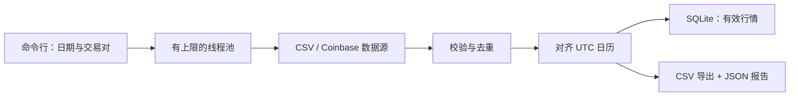

# Market Data Pipeline

本地已通过 **101 项测试**。环境、验证范围和真实接口测试见[验证记录](docs/VERIFICATION.md)。
需要使用本地验证过的运行依赖版本时，执行 `python -m pip install -r requirements-lock.txt`。

**把每日加密货币行情整理成可核验、可复用的数据集。**

[](https://github.com/harper698/market-data-pipeline/actions/workflows/ci.yml)

[English](README.md) · [快速开始](#快速开始) · [演示输出](examples/demo-output/) · [数据处理规则](#数据处理规则)

这个 Python 命令行项目支持并发获取多个交易对的日线数据，校验每根 K 线，显式标记缺失日期，并把有效记录保存到 SQLite。项目附带确定性的离线演示，不需要 API 密钥或网络即可验证完整流程。

这是一个独立的数据工程作品，展示数据采集、质量校验、故障处理、持久化和可复现验证能力。

## 它能做什么

- **采集数据**：读取本地 CSV，或获取 Coinbase Exchange 的公开日线行情；按接口限制拆分较长日期区间。
- **处理故障**：对网络暂时故障、HTTP 429 和服务端错误进行有限次数重试，设置超时和有上限的退避等待。
- **检查质量**：识别无效时间戳、异常价格、矛盾的 OHLC 关系和无效成交量；统计剔除记录和冲突重复值。
- **对齐日期**：按每个交易对补齐 UTC 日历；缺失行情保留为空值，不虚构价格或成交量。
- **保存结果**：以 `(source, symbol, timestamp)` 为唯一键，将有效行情在事务中写入或更新至 SQLite。
- **便于检查**：输出对齐后的长表、收盘价宽表和 JSON 质量报告。某个交易对失败时，其他交易对的成功结果仍会保存。

## 技术栈

Python 3.11+ · pandas · requests · SQLite · pytest · Ruff · GitHub Actions

使用标准库 `concurrent.futures` 实现有上限的并发采集。SQLite 无需单独部署数据库服务。代码按职责拆分，优先保证可维护性和可验证性。

## 快速开始

### 1. 安装

```sh
git clone https://github.com/harper698/market-data-pipeline.git
cd market-data-pipeline
python -m venv .venv
```

根据终端选择激活命令：

| 终端 | 命令 |
| --- | --- |
| Windows PowerShell | `.venv\Scripts\Activate.ps1` |
| Windows 命令提示符 | `.venv\Scripts\activate.bat` |
| macOS / Linux | `source .venv/bin/activate` |

```sh
python -m pip install -r requirements.txt
```

如果 PowerShell 禁止执行激活脚本，可以直接用 `.venv\Scripts\python.exe` 替代 `python`，用 `.venv\Scripts\marketpipe.exe` 替代 `marketpipe`，无需修改系统执行策略。

### 2. 运行离线演示

下面的单行命令可直接在 PowerShell 或 macOS / Linux 终端运行：

```sh
marketpipe --provider csv --data-dir examples/raw --symbols BTC-USD ETH-USD --start 2025-01-01 --end 2025-01-08 --db output/demo.sqlite --output output/demo
```

示例数据是**合成数据，并非真实市场价格**。它刻意包含异常记录、重复记录和缺失日期，用来演示数据清洗规则。上述区间共有 7 天，每个成功采集的交易对会输出 7 行对齐记录，其中包含缺失行。

随附样本的实际验证结果：

| 交易对 | 输入行数 | 有效 K 线 | 缺失天数 | 无效行数 | 重复行数 | 存在冲突的时间戳数 |
| --- | ---: | ---: | ---: | ---: | ---: | ---: |
| BTC-USD | 7 | 5 | 2 | 1 | 1 | 1 |
| ETH-USD | 7 | 7 | 0 | 0 | 0 | 0 |

本次运行生成 **14 行对齐记录，保存 12 根有效 K 线**。重复执行后 K 线数量仍为 12，`runs` 审计表会新增一条运行记录。仓库提供可直接查看的[演示输出](examples/demo-output/)：`aligned.csv`、`closes.csv` 和 `quality.json`，无需安装即可检查结果。其中 `quality.json` 保存演示质量统计；常规运行输出的是下表中的完整 `report.json`。

| 输出文件 | 用途 |
| --- | --- |
| `output/demo.sqlite` | 按来源隔离保存的有效行情历史 |
| `output/demo/aligned.csv` | 每个成功采集的交易对、每个请求日期一行，包含缺失行 |
| `output/demo/closes.csv` | 日期为行、交易对为列的收盘价宽表 |
| `output/demo/report.json` | 各交易对的质量统计和采集失败信息 |

### 3. 获取真实日线行情

```sh
marketpipe --provider coinbase --symbols BTC-USD ETH-USD --start 2025-01-01 --end 2025-02-01 --db output/live.sqlite --output output/live
```

项目调用 Coinbase Exchange 的公开行情接口，不需要 API 密钥或交易账户，也不执行下单。实际访问情况和历史数据覆盖范围取决于提供方。

2026 年 10 月 4 日的真实接口冒烟验证中，上述 2025 年 1 月区间每个交易对返回 31 根 K 线，共 62 根有效 K 线，无缺失或无效记录。这是一次实际验证结果，不代表未来数据覆盖保证。

运行 `marketpipe --help` 查看完整参数。默认使用 4 个采集线程，上限为 8 个；每次最多接受 50 个不同的交易对和 3,660 天的日期区间。

## 数据处理规则

| 项目 | 规则 |
| --- | --- |
| 时间范围 | 使用 UTC 日线，包含 `start`，不包含 `end`；拒绝包含当日尚未完成 K 线的区间。 |
| 时间戳 | 必须可解析，并在转换为 UTC 后对齐到午夜。 |
| 价格 | 开、高、低、收必须为有限正数，且满足最低价 ≤ 开盘价/收盘价 ≤ 最高价。 |
| 成交量 | 必须为有限非负数；零成交量有效。 |
| 无效记录 | 对齐前剔除，并计入质量报告。 |
| 重复记录 | 按来源输入顺序保留最后一条有效记录；数值冲突另行统计。这是确定性选择规则，并不代表最后一条一定更权威。 |
| 缺失日期 | OHLCV 保持为空，标记 `is_missing=true`，不前向填充。 |
| 来源隔离 | CSV 与 Coinbase 的记录独立保存，同一交易对、同一天不会混淆。 |
| 重复运行 | 有效记录执行写入或更新，重复采集不会增加重复数据库记录。 |
| 已存历史 | 本次缺失不会删除数据库中此前保存的有效行情。 |
| 导出范围 | CSV 和 JSON 报告反映**本次采集**，不是数据库内所有历史记录的合并结果。 |

长表导出列如下：

```text
source,symbol,timestamp,open,high,low,close,volume,is_missing
```

本地输入文件放在 `<data-dir>/<SYMBOL>.csv`，包含 `timestamp,open,high,low,close,volume` 六列。建议使用带明确时区的 ISO 8601 时间戳。

### 质量控制与退出码

| 退出码 | 含义 |
| --- | --- |
| `0` | 所有交易对采集成功，但仍可能存在数据缺口。 |
| `1` | 命令或配置无效，或出现输出写入失败等运行级故障。 |
| `2` | 至少一个交易对失败；成功处理的交易对仍会保存。 |
| `3` | 启用 `--strict-quality` 后，发现缺失行情、被剔除记录或冲突重复值。 |

下游任务要求完整、干净的数据时，可添加 `--strict-quality`。采集成功不等于数据完整，应同时查看质量报告。

采集失败的退出码优先于严格质量检查。失败的交易对会记录在 `report.json` 中，在 `closes.csv` 中显示为空列，在 `aligned.csv` 中没有对应行。超出请求范围的输入记录单独统计，不计入无效记录数。

## 架构



采集故障按交易对分别记录，避免单个市场不可用时丢弃其他成功结果。数据库只保存有效行情，导出文件还会包含请求日历中的缺失行。

SQLite 行情更新和运行审计记录位于同一个事务中。CSV 与报告采用逐文件原子替换，但数据库与全部导出文件**不属于同一个事务**。输出失败时，数据库可能已写入成功，导出目录也可能只有部分文件完成更新。需要保留快照时，为每次运行指定不同的 `--output` 目录。

[Coinbase 官方 K 线接口文档](https://docs.cdp.coinbase.com/api-reference/exchange-api/rest-api/products/get-product-candles)说明：单次请求最多返回 300 根 K 线，历史数据可能不完整，响应也可能包含早于请求起点的记录。项目按日拆分请求区间，并过滤到自身约定的时间范围。

### 读取已保存的数据

按来源和交易对查询，避免混用合成数据与真实行情：

```python
import sqlite3

import pandas as pd

with sqlite3.connect("output/demo.sqlite") as connection:
    candles = pd.read_sql_query(
        """
        SELECT timestamp, open, high, low, close, volume
        FROM candles
        WHERE source = ? AND symbol = ?
        ORDER BY timestamp
        """,
        connection,
        params=("csv", "BTC-USD"),
        parse_dates=["timestamp"],
    )

print(candles.tail())
```

如需按日期对齐分析，可读取 `closes.csv`，并在计算收益率前明确决定如何处理缺失值。

## 开发与验证

```sh
python -m pip install -e ".[dev]"
python -m pytest
python -m ruff check .
```

测试使用本地样本和模拟 HTTP 响应，常规验证不依赖真实 API 可用性。GitHub Actions 在 Python 3.11、3.12 和 3.13 上执行检查。

## 适用范围

- 目前仅处理加密货币日线；不包含股票交易日历、复权、盘中行情或实时数据流。
- 有限重试用于应对暂时故障，无法保证数据源始终可用，也无法补出来源从未发布的数据。
- 校验覆盖结构与内部一致性，无法单独证明一个看起来合理的价格与真实市场一致。
- SQLite 适合本地小型研究数据集。任务调度、远程部署和多写入方协调不在本项目范围内。
- 提供方可能修订历史数据；研究需要精确复现时，应保留本次导出的快照。

## 许可证

[MIT](LICENSE)
